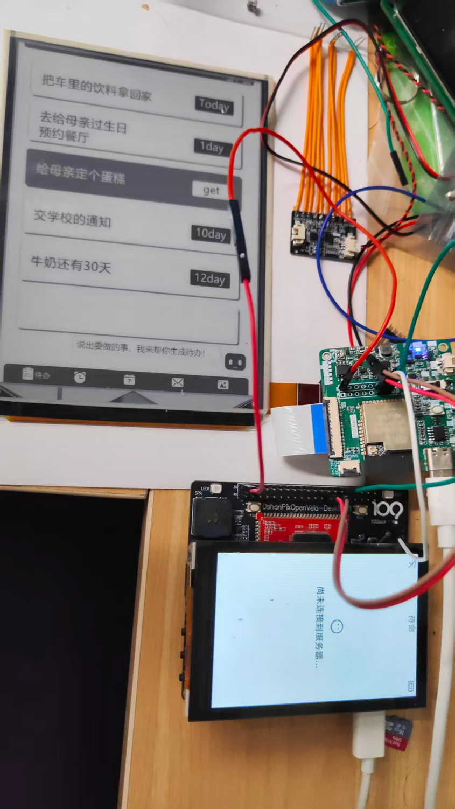

# 6 寸墨水屏语音待办



本项目是 openvela/NuttX 上的 6 寸并口墨水屏待办应用。主控通过 SPI 连接墨水屏驱动板，负责维护待办数据并发送刷新帧；驱动板负责波形、显存转换和面板时序。本仓库不包含驱动板固件。

## 功能

- `epaper_todo` 应用维护最多 32 条待办，支持添加、修改、完成、删除和刷新。
- `epaper_todo mcp` 在标准输入/输出上提供 JSON-RPC 2.0 MCP 服务，供小智语音侧调用。
- 每次数据变化自动发送完整待办列表，避免驱动板保存业务状态。

## 目录

- `app/epaper_todo/`：主控应用、MCP 服务和 SPI 协议实现。
- `board/contest_board/`：开发板适配示例（仍需按实际主控补 SPI 总线和设备节点）。
- `contest2026_191_AItansuoju.xml`：将应用映射到 openvela 构建树的 manifest。

## SPI 接线

主控 `SCK/MOSI/CS/GND` 连接驱动板对应 SPI 引脚，另接 `BUSY/RESET` 由驱动板自行处理。电平必须为 3.3 V；不要把 6 寸并口屏的高压或并口信号直接接到主控。默认设备节点为 `/dev/spidev0.0`，可在 Kconfig 中修改 `EPAPER_TODO_SPI_DEV`。

## 指令协议（主控到驱动板）

每个 SPI 事务发送一个完整帧：

```text
A5 5A | version(1) | command(1) | sequence(1) | length(u16 big-endian) |
payload(length) | crc16(u16 little-endian)
```

CRC16 为多项式 `0xA001`、初值 `0xFFFF`，覆盖 `version` 到 payload。当前指令：`0x10 REFRESH`，payload 为 UTF-8 文本 `TODOLIST\\n`，后续每行格式为 `id|状态|标题\\n`，状态为 `x` 或空格；`0x11 CLEAR` 预留给驱动板清屏。驱动板收到未知版本或 CRC 错误应丢弃整帧。

## MCP 工具

```text
todo_add    {"text":"缴电费"}
todo_update {"id":1,"text":"缴电费（已开票）","done":false}
todo_delete {"id":1}
todo_refresh {}
```

语音服务只需把“添加待办”“修改待办”“刷新墨水屏”等意图转换为上述工具调用。`todo_update` 可只传 `id` 和 `done` 来标记完成。应用也支持串口调试：`epaper_todo add <text>`、`epaper_todo done <id>`、`epaper_todo refresh`。

## 构建与运行

将本仓库作为 manifest 工程同步后，在 openvela 工作区根目录执行：

```bash
./build.sh <board-config-path> menuconfig
# 启用 Applications -> 6-inch e-paper todo and Xiaozhi MCP service
./build.sh <board-config-path> -j8
```

启动后运行 `epaper_todo mcp`，将其标准输入/输出接入小智 MCP 通道。实际 SPI 设备节点、片选和频率由具体开发板配置；驱动板固件按本协议接收文本并完成 6 寸并口屏刷新。

## 当前边界

应用使用易移植的字符设备 `write()` 发送 SPI 帧。若目标 BSP 的 SPI 驱动要求 `ioctl` 配置模式、频率或字长，请在 `spi_frame()` 中打开设备后补充对应 ioctl；待办和 MCP 层无需修改。
